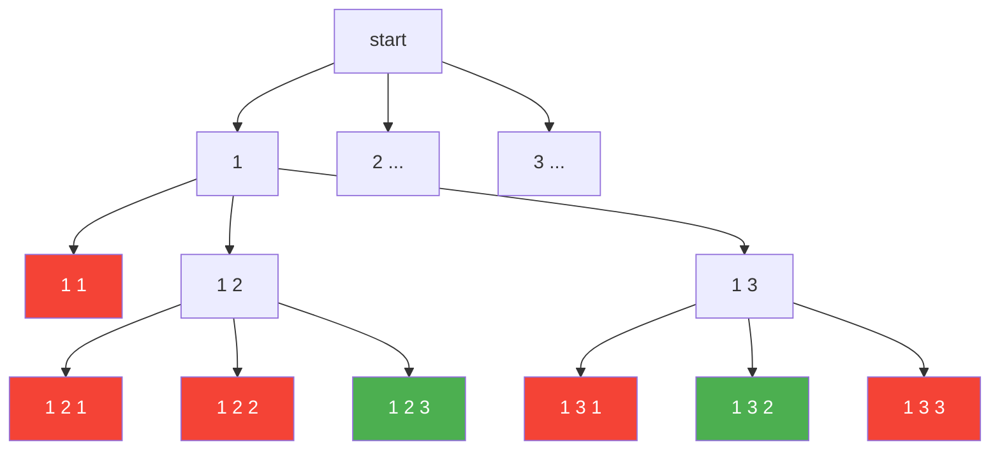
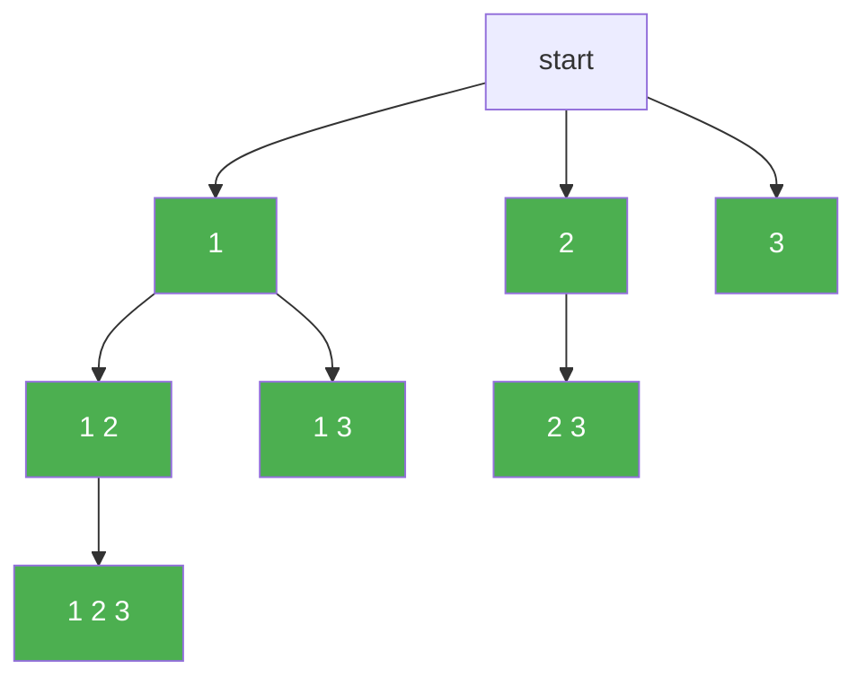

# Backtracking

**Backtracking** este metoda prin care construim solutia unei probleme **pas cu pas** si eliminam solutiile proaste **pe parcursul** construirii ei. Merg mai departe cu construirea solutiei doar daca solutia mea este **inca valida**.

Numele vine din engleza si inseamna, aproximativ, "a merge inapoi pe urmele tale". Cand pe un drum nu mai pot continua, ma intorc un pas si incerc o alta varianta.

Metoda se foloseste la problemele in care trebuie **generate toate solutiile** care respecta anumite conditii: toate permutarile unei multimi, toate submultimile de cate `m` elemente, toate modurile de a aseza ceva pe o tabla si asa mai departe.

---

## Ideea metodei

Sa presupunem ca vrem toate permutarile multimii `{1, 2, 3}`, adica toate modurile de a aseza numerele `1`, `2`, `3` intr-un sir, fiecare o singura data.

Solutia o tinem intr-un vector `sol`, pe care il completam **pozitie cu pozitie**:

- la **pasul 1** aleg ce pun pe `sol[1]`;
- la **pasul 2** aleg ce pun pe `sol[2]`;
- la **pasul 3** aleg ce pun pe `sol[3]`.

La fiecare pas incerc pe rand toate valorile posibile (`1`, `2`, `3`), dar **pun** o valoare doar daca solutia ramane valida. De exemplu, daca am deja `sol[1] = 1`, la pasul 2 valoarea `1` este respinsa imediat — nu are rost sa construiesc mai departe ceva ce incepe cu `1 1`, pentru ca oricum nu poate deveni o permutare.

Asta este diferenta fata de "incerc tot si vad la final ce e bun": o varianta proasta este **taiata din prima**, impreuna cu toate continuarile ei.

> [!NOTE] Observatie
> Un vector `sol` completat doar pana la un anumit pas (de exemplu `1 3`, cand permutarea are 3 elemente) se numeste **solutie partiala**. Backtracking-ul lucreaza tot timpul cu solutii partiale si le duce mai departe doar pe cele care pot ajunge solutii complete.

---

## Sablonul general

Construirea solutiei o scriem ca o functie recursiva `bkt(k)`, unde `k` este **pasul** la care am ajuns, adica pozitia din `sol` pe care o completez acum.

```cpp
void bkt(int k)
{
    if (amGasitSolutie())        // de obicei: k == n + 1
    {
        afisezSolutia();
        return;
    }

    int i;

    // sunt la pasul k in construirea solutiei
    for (i = primaValoare; i <= ultimaValoare; i++)
    {
        if (pot pune i pe pozitia k)
        {
            sol[k] = i;          // il pun in solutie
            bkt(k + 1);          // trec la pasul urmator
        }
    }
}
```

Apelul din `main` este `bkt(1)` — adica "incepe cu pasul 1".

Functia are doua parti, exact ca orice functie recursiva:

**Cazul de baza: am gasit o solutie.** Daca am ajuns la un pas dupa ultimul, inseamna ca toate pozitiile din `sol` sunt completate — am o solutie completa. O afisez si ma opresc cu `return`.

**Cazul general: completez pozitia `k`.** `for`-ul incearca pe rand toate valorile care ar putea sta pe pozitia `k`. Pentru fiecare valoare care **pastreaza solutia valida**, o pun in `sol[k]` si apelez `bkt(k + 1)`, ca sa completez restul.

> [!IMPORTANT] Important
> Daca solutia mea are dimensiunea `n`, atunci **`n` este ultimul pas la care mai construiesc** (completez) solutia, iar **pasul `n + 1` este cel la care afisez si ma opresc**. De aceea conditia de oprire este `k == n + 1`, nu `k == n`: la pasul `n` inca nu am pus nimic pe `sol[n]`.

### Unde este "intoarcerea"?

In sablon nu scrie nicaieri "intoarce-te un pas". Intoarcerea se face singura, prin recursie:

- cand `for`-ul de la pasul `k` isi termina toate valorile, functia `bkt(k)` se incheie;
- executia revine in `bkt(k - 1)`, exact in locul de unde fusese apelata — adica in interiorul `for`-ului de la pasul `k - 1`;
- acel `for` trece la **urmatoarea valoare** pentru pozitia `k - 1`.

Asta este "pasul inapoi" din numele metodei.

> [!WARNING] Atentie
> Variabila `i` din `bkt` trebuie sa fie **locala**, declarata in functie. Este o exceptie de la regula cu variabilele globale, si una foarte importanta: fiecare apel `bkt(k)` are nevoie de **propriul** `i`, ca sa stie, cand se revine in el, la ce valoare ramasese. Un `i` global ar fi impartit de toate apelurile si s-ar strica de la primul apel recursiv. Vezi [capcana 1](#_1-i-declarat-global).

---

## Exemplu — permutarile multimii `{1, 2, ..., n}`

Se citeste un numar natural `n`. Sa se afiseze, in ordine lexicografica, toate permutarile multimii `{1, 2, ..., n}`.

Aceasta este problema **Permutari** de pe pbinfo.

Ca sa potrivim problema pe sablon, raspundem la trei intrebari:

1. **Ce dimensiune are solutia?** O permutare are `n` elemente, deci completez `sol[1..n]` si ma opresc la pasul `n + 1`.
2. **Ce valori pot sta pe o pozitie?** Orice numar de la `1` la `n`.
3. **Cand pot pune valoarea `i` pe pozitia `k`?** Cand `i` nu apare deja pe vreuna din pozitiile completate inainte, `sol[1..k-1]`.

```cpp
#include <iostream>
using namespace std;

int n, sol[11];

void afisare()
{
    int i;

    for (i = 1; i <= n; i++)
    {
        cout << sol[i] << " ";
    }
    cout << "\n";
}
bool valid(int k, int x)
{
    int i;

    for (i = 1; i < k; i++)
    {
        if (sol[i] == x)
            return false;
    }
    return true;
}
void bkt(int k)
{
    if (k == n + 1)
    {
        afisare();
        return;
    }

    int i;

    for (i = 1; i <= n; i++)
    {
        if (valid(k, i))
        {
            sol[k] = i;
            bkt(k + 1);
        }
    }
}
int main()
{
    cin >> n;
    bkt(1);
    return 0;
}
```

**Intrare:**
```
3
```

**Afisare:**
```
1 2 3
1 3 2
2 1 3
2 3 1
3 1 2
3 2 1
```

> [!NOTE] Observatie
> Permutarile ies **in ordine lexicografica** fara niciun efort in plus: la fiecare pas, `for`-ul incearca valorile in ordine crescatoare, deci solutiile care incep cu `1` apar inaintea celor care incep cu `2`, si asa mai departe.

### Arborele de cautare

Toate incercarile facute de `bkt` formeaza un **arbore**. Fiecare nivel este un pas, iar fiecare nod este o solutie partiala. Mai jos este doar ramura care incepe cu `1`; ramurile care incep cu `2` si cu `3` arata la fel.



Nodurile **rosii** sunt valorile respinse de `valid` — acolo nu se mai face niciun apel, deci tot ce ar fi crescut sub ele dispare. Nodurile **verzi** sunt solutii complete.

Observa nodul `1 1`: este respins la pasul 2, deci variantele `1 1 1`, `1 1 2`, `1 1 3` **nici nu sunt construite**. Asta este "eliminarea pe parcurs" din definitie.

### Sa urmarim executia pas cu pas

Pentru `n = 3`, primele doua solutii se obtin asa:

| Apelul | Ce se intampla | `sol` |
|---|---|---|
| `bkt(1)` | `i = 1` este valid, il pun pe pozitia 1 | `1` |
| `bkt(2)` | `i = 1` respins (exista deja); `i = 2` valid | `1 2` |
| `bkt(3)` | `i = 1`, `i = 2` respinse; `i = 3` valid | `1 2 3` |
| `bkt(4)` | `k == n + 1` — afisez `1 2 3` si ies | `1 2 3` |
| `bkt(3)` | `for`-ul s-a terminat, ies | |
| `bkt(2)` | revin aici si continui cu `i = 3`, valid | `1 3` |
| `bkt(3)` | `i = 1` respins; `i = 2` valid | `1 3 2` |
| `bkt(4)` | afisez `1 3 2` si ies | `1 3 2` |
| `bkt(3)` | `i = 3` respins, `for`-ul s-a terminat, ies | |
| `bkt(2)` | `for`-ul s-a terminat, ies | |
| `bkt(1)` | revin aici si continui cu `i = 2`, valid | `2` |
| ... | | |

> [!TIP] Sfat
> Cand se revine in `bkt(2)` si se pune `sol[2] = 3`, in `sol[3]` a ramas de la solutia anterioara valoarea `3`. Nu este o problema si **nu trebuie sters**: la pasul `k`, `valid` se uita doar la `sol[1..k-1]`, iar `sol[3]` va fi oricum suprascris inainte sa ajunga intr-o solutie afisata.

---

## Varianta cu vector de aparitii

Functia `valid` de mai sus parcurge la fiecare verificare toata solutia partiala. Putem raspunde instantaneu la intrebarea "a mai fost folosita valoarea `i`?" daca tinem un [vector caracteristic](../clasa-a-9a/vectori/vector-de-frecventa) `folosit`, unde `folosit[i]` este `true` daca valoarea `i` se afla deja in solutie.

```cpp
#include <iostream>
using namespace std;

int n, sol[11];
bool folosit[11];

void afisare()
{
    int i;

    for (i = 1; i <= n; i++)
    {
        cout << sol[i] << " ";
    }
    cout << "\n";
}
void bkt(int k)
{
    if (k == n + 1)
    {
        afisare();
        return;
    }

    int i;

    for (i = 1; i <= n; i++)
    {
        if (!folosit[i])
        {
            sol[k] = i;
            folosit[i] = true;
            bkt(k + 1);
            folosit[i] = false;
        }
    }
}
int main()
{
    cin >> n;
    bkt(1);
    return 0;
}
```

**Intrare:**
```
3
```

**Afisare:**
```
1 2 3
1 3 2
2 1 3
2 3 1
3 1 2
3 2 1
```

> [!IMPORTANT] Important
> Linia `folosit[i] = false;` de **dupa** apelul recursiv este obligatorie. Cand `bkt(k + 1)` se termina, valoarea `i` **iese** din solutie (pe pozitia `k` urmeaza sa pun alta valoare), deci trebuie marcata din nou ca libera. Regula de memorat: **ce marchez inainte de apel, demarchez dupa apel.**

> [!NOTE] Observatie
> La `sol[k]` nu e nevoie de "demarcare", pentru ca valoarea de pe pozitia `k` se suprascrie la urmatoarea iteratie a `for`-ului. La `folosit` insa, `i` si urmatoarea valoare sunt pozitii **diferite** in vector, deci nimeni nu sterge marcajul in locul nostru.

---

## Exemplu — aranjamente

Se citesc doua numere naturale `n` si `m`, cu `m <= n`. Sa se afiseze, in ordine lexicografica, toate aranjamentele de `n` luate cate `m`, adica toate sirurile de `m` numere **distincte** din multimea `{1, 2, ..., n}`.

Aceasta este problema **Aranjamente** de pe pbinfo. In enunt al doilea numar se numeste `k`; aici il numim `m`, ca sa nu se confunde cu pasul `k` din `bkt`.

Fata de permutari se schimba **un singur lucru**: dimensiunea solutiei. Solutia are `m` elemente, nu `n`, deci ultimul pas la care completez este `m`, iar la pasul `m + 1` afisez. Valorile posibile raman `1..n`, iar conditia de validitate ramane aceeasi: valoarea sa nu fi fost folosita.

```cpp
#include <iostream>
using namespace std;

int n, m, sol[11];
bool folosit[11];

void afisare()
{
    int i;

    for (i = 1; i <= m; i++)
    {
        cout << sol[i] << " ";
    }
    cout << "\n";
}
void bkt(int k)
{
    if (k == m + 1)
    {
        afisare();
        return;
    }

    int i;

    for (i = 1; i <= n; i++)
    {
        if (!folosit[i])
        {
            sol[k] = i;
            folosit[i] = true;
            bkt(k + 1);
            folosit[i] = false;
        }
    }
}
int main()
{
    cin >> n >> m;
    bkt(1);
    return 0;
}
```

**Intrare:**
```
3 2
```

**Afisare:**
```
1 2
1 3
2 1
2 3
3 1
3 2
```

> [!TIP] Sfat
> Retine cele doua "limite" diferite din program: `n` spune **ce valori** pot pune (`for`-ul merge pana la `n`), iar `m` spune **cate pozitii** completez (ma opresc la `m + 1`). La permutari cele doua coincid, de aceea acolo apare doar `n`.

---

## Exemplu — combinari

Se citesc doua numere naturale `n` si `m`, cu `m <= n`. Sa se afiseze, in ordine lexicografica, toate submultimile de cate `m` elemente ale multimii `{1, 2, ..., n}`.

Aceasta este problema **Combinari** de pe pbinfo (si aici, in enunt, `m` se numeste `k`).

Diferenta fata de aranjamente: la o submultime **nu conteaza ordinea**. `1 2` si `2 1` sunt aceeasi submultime, deci trebuie afisata o singura data. O afisam in forma ei crescatoare, `1 2`.

Asta ne da conditia: solutia trebuie sa fie **strict crescatoare**, adica `sol[k] > sol[k - 1]`. Iar aceasta conditie o putem pune direct in `for`, nu intr-un `if`: pe pozitia `k` incerc doar valorile **mai mari** decat `sol[k - 1]`.

```cpp
#include <iostream>
using namespace std;

int n, m, sol[11];

void afisare()
{
    int i;

    for (i = 1; i <= m; i++)
    {
        cout << sol[i] << " ";
    }
    cout << "\n";
}
void bkt(int k)
{
    if (k == m + 1)
    {
        afisare();
        return;
    }

    int i;

    for (i = sol[k - 1] + 1; i <= n; i++)
    {
        sol[k] = i;
        bkt(k + 1);
    }
}
int main()
{
    cin >> n >> m;
    bkt(1);
    return 0;
}
```

**Intrare:**
```
4 2
```

**Afisare:**
```
1 2
1 3
1 4
2 3
2 4
3 4
```

Doua lucruri de observat:

**Nu mai exista niciun `if`.** Orice valoare din intervalul `sol[k - 1] + 1 .. n` este automat mai mare decat cea dinainte, deci automat diferita de toate cele dinainte. Nu mai am nevoie nici de `valid`, nici de `folosit`.

**`sol[0]` joaca rol de "santinela".** La pasul 1, `for`-ul porneste de la `sol[0] + 1`. Vectorul `sol` este global, deci `sol[0]` este `0`, iar `for`-ul porneste de la `1` — exact ce vrem.

> [!TIP] Sfat
> Ori de cate ori conditia de validitate se poate scrie ca o **limita a intervalului** de valori, pune-o direct in `for`. Valorile care nu au ce cauta acolo nici nu mai sunt incercate, iar codul devine mai scurt.

---

## Exemplu — submultimi

Se citeste un numar natural `n`. Sa se afiseze, in ordine lexicografica, toate submultimile nevide ale multimii `{1, 2, ..., n}`, fiecare cu elementele in ordine crescatoare.

Pornim de la combinari si pastram aceeasi idee: solutia este **strict crescatoare**, deci pe pozitia `k` incerc doar valorile de la `sol[k - 1] + 1` pana la `n`. Ca si acolo, o submultime apare o singura data, in forma ei crescatoare.

Diferenta este ca acum submultimile **nu mai au toate aceeasi dimensiune**. `1`, `1 2` si `1 2 3` sunt toate solutii. Asta inseamna ca **orice solutie partiala este si o solutie completa**: de fiecare data cand pun o valoare pe pozitia `k`, `sol[1..k]` este o submultime buna, pe care o afisez pe loc. Apoi incerc sa o prelungesc cu `bkt(k + 1)`.

```cpp
#include <iostream>
using namespace std;

int n, sol[11];

void afisare(int k)
{
    int i;

    for (i = 1; i <= k; i++)
    {
        cout << sol[i] << " ";
    }
    cout << "\n";
}
void bkt(int k)
{
    int i;

    for (i = sol[k - 1] + 1; i <= n; i++)
    {
        sol[k] = i;
        afisare(k);
        bkt(k + 1);
    }
}
int main()
{
    cin >> n;
    bkt(1);
    return 0;
}
```

**Intrare:**
```
3
```

**Afisare:**
```
1
1 2
1 2 3
1 3
2
2 3
3
```

Doua lucruri s-au schimbat fata de sablon:

**Afisarea se face in `for`, nu in cazul de baza.** Nu mai astept sa ajung la un anumit pas: fiecare valoare pusa in solutie produce imediat o submultime noua. De aceea `afisare` primeste ca parametru pe `k`, ca sa stie cate elemente sa afiseze.

**Nu mai exista conditia `k == n + 1`.** Oprirea se face singura: daca `sol[k - 1]` este deja `n`, intervalul `n + 1 .. n` este gol, `for`-ul nu se executa deloc, iar `bkt(k)` se incheie fara alt apel recursiv. Cel mai departe se ajunge la `bkt(n + 1)`, dupa submultimea `1 2 ... n`.

### Arborele de cautare



Aici **toate nodurile sunt verzi**: fiecare nod al arborelui este o submultime afisata. Ordinea de afisare este ordinea in care sunt vizitate nodurile — mai intai nodul, apoi tot ce este sub el, de la stanga la dreapta.

> [!NOTE] Observatie
> Multimea `{1, 2, ..., n}` are `2` la puterea `n` submultimi, dintre care una este multimea vida. Programul nu o afiseaza, pentru ca afisarea se face doar dupa ce am pus macar un element in `sol`. Pentru `n = 3` sunt `2^3 - 1 = 7` submultimi nevide, exact cate apar mai sus.

> [!TIP] Sfat
> Daca problema cere submultimile **grupate dupa numarul de elemente** (intai cele cu un element, apoi cele cu doua etc.), nu ai nevoie de un program nou: in `main` apelezi programul de la [combinari](#exemplu-—-combinari) pentru fiecare dimensiune pe rand:
>
> ```cpp
> for (m = 1; m <= n; m++)
> {
>     bkt(1);
> }
> ```
>
> unde `m` este variabila globala care da dimensiunea solutiei in `bkt`.

---

## Cat de rapid este backtracking-ul?

Backtracking-ul genereaza **toate** solutiile, iar la multe probleme numarul lor creste ametitor. Permutarile de `n` elemente sunt `n!` (n factorial):

| `n` | Numarul de permutari `n!` |
|---|---|
| `3` | `6` |
| `5` | `120` |
| `8` | `40.320` |
| `10` | `3.628.800` |
| `12` | `479.001.600` |
| `15` | `1.307.674.368.000` |

Pana pe la `n = 10` programul termina in timp util; la `n = 15`, doar afisarea ar dura zile.

Eliminarea pe parcurs face insa o diferenta enorma fata de varianta "incerc tot". Daca am completa toate cele `n` pozitii cu orice valoare de la `1` la `n` si am verifica abia la final, ar trebui construite `n` la puterea `n` siruri. Pentru `n = 8` asta inseamna `16.777.216` de siruri, din care doar `40.320` sunt permutari.

> [!NOTE] Observatie
> Din acest motiv, la problemele de backtracking datele de intrare sunt mereu **mici** (de obicei `n <= 10`). Daca vezi intr-un enunt ca trebuie generate *toate* variantele si ca `n` este mic, aproape sigur se cere backtracking.

> [!TIP] Sfat
> Adancimea maxima a stivei de apeluri este doar `n + 1` (de la `bkt(1)` pana la `bkt(n + 1)`). Problema backtracking-ului nu este niciodata *stack overflow*, ci **timpul**: numarul total de apeluri.

---

## Capcane frecvente

### 1. `i` declarat global

```cpp
int n, i, sol[11];   // gresit: i este global

void bkt(int k)
{
    if (k == n + 1)
    {
        afisare();
        return;
    }

    for (i = 1; i <= n; i++)
    {
        if (valid(k, i))
        {
            sol[k] = i;
            bkt(k + 1);
        }
    }
}
```

Toate apelurile folosesc **acelasi** `i`. Cand `bkt(3)` isi termina `for`-ul, `i` a ajuns la `n + 1`. Se revine in `bkt(2)`, care ar trebui sa continue cu urmatoarea valoare — dar `i` este deja `n + 1`, deci si `for`-ul din `bkt(2)` se termina imediat, si la fel cel din `bkt(1)`. Pentru `n = 3` programul afiseaza doar `1 2 3` si se opreste.

Contorul `for`-ului din `bkt` se declara **mereu local**, in functie.

### 2. Conditia de oprire `k == n` in loc de `k == n + 1`

```cpp
if (k == n)   // gresit
{
    afisare();
    return;
}
```

La pasul `n` pozitia `sol[n]` **inca nu a fost completata**. Pentru `n = 3`, programul afiseaza `1 2 0`, `1 3 0`, `2 1 0`, ... — ultimul element este `0`, valoarea initiala a vectorului global. Retine: `n` este ultimul pas la care **completez**, `n + 1` este pasul la care **afisez**.

### 3. Uiti sa demarchezi in vectorul de aparitii

```cpp
sol[k] = i;
folosit[i] = true;
bkt(k + 1);
// lipseste: folosit[i] = false;
```

Dupa prima solutie, `1 2 3`, toate valorile raman marcate ca folosite si nu mai pot fi puse nicaieri. Programul afiseaza doar prima permutare.

### 4. Lipseste `return` dupa afisare

```cpp
if (k == m + 1)
{
    afisare();
    // lipseste: return;
}
```

Programul trece mai departe in `for` si incearca sa completeze pozitia `m + 1`, `m + 2` si asa mai departe — pozitii care nu fac parte din solutie. In cel mai bun caz pierde timp construind lucruri pe care nu le afiseaza niciodata; in cel mai rau caz scrie in afara vectorului `sol`.

---

## De retinut

- **Backtracking** construieste solutia pas cu pas si merge mai departe doar cu solutiile partiale care sunt **inca valide**. O varianta proasta este eliminata imediat, impreuna cu toate continuarile ei.
- Solutia se tine in vectorul `sol`; la pasul `k` se completeaza `sol[k]`. Apelul initial este `bkt(1)`.
- Daca solutia are dimensiunea `n`, **`n` este ultimul pas la care completez**, iar **la pasul `n + 1` afisez si ma opresc**.
- Pentru fiecare problema raspunde la trei intrebari: *ce dimensiune are solutia?*, *ce valori pot sta pe o pozitie?*, *cand pot pune valoarea `i` pe pozitia `k`?*
- "Intoarcerea" o face recursia: cand `for`-ul de la pasul `k` se termina, executia revine la pasul `k - 1`, care incearca urmatoarea valoare.
- Contorul `i` din `bkt` este **local**, nu global.
- La vectorul de aparitii: **ce marchez inainte de apel, demarchez dupa apel.**
- Cand se poate, pune conditia de validitate in limitele `for`-ului (ca la combinari, unde pornim de la `sol[k - 1] + 1`).
- Cand **orice solutie partiala este si solutie** (ca la submultimi), afisarea se face in `for`, imediat dupa ce pui valoarea, iar conditia `k == n + 1` nu mai este necesara.
- Numarul de solutii creste foarte repede, de aceea problemele de backtracking au mereu date de intrare mici.
