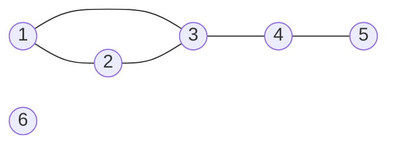
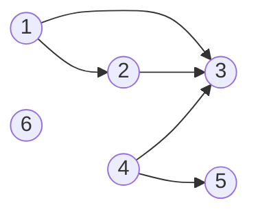
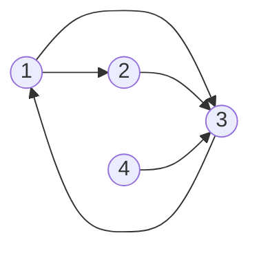
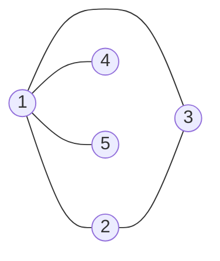

# Gradul unui nod

In lectia [Introducere in grafuri](/cpp/algoritmi/clasa-a-11a/grafuri/introducere) am vazut doua grafuri cu aceleasi `6` noduri. Le refolosim aici.

**Graful neorientat** (`m = 5` muchii):

**Graful orientat** (`m = 5` arce):

---

## Gradul unui nod

### La graful neorientat

**Gradul** nodului `x`, notat `d(x)`, este numarul de muchii incidente cu `x`, adica **numarul de vecini** ai lui `x`.

Pentru graful neorientat de mai sus:

| Nod | 1 | 2 | 3 | 4 | 5 | 6 |
|---|---|---|---|---|---|---|
| vecini | 2, 3 | 1, 3 | 1, 2, 4 | 3, 5 | 4 | — |
| `d(x)` | 2 | 2 | 3 | 2 | 1 | 0 |

Doua tipuri de noduri au nume speciale:

- un nod cu `d(x) = 0` este **nod izolat** (in exemplu: `6`);
- un nod cu `d(x) = 1` este **nod terminal** (in exemplu: `5`).

### La graful orientat

La graful orientat, fiecare nod are **doua** grade:

- **gradul exterior** `d⁺(x)` — numarul de arce care **pleaca** din `x`;
- **gradul interior** `d⁻(x)` — numarul de arce care **intra** in `x`.

Pentru graful orientat de mai sus:

| Nod | 1 | 2 | 3 | 4 | 5 | 6 |
|---|---|---|---|---|---|---|
| arce care pleaca spre | 2, 3 | 3 | — | 3, 5 | — | — |
| arce care intra dinspre | — | 1 | 1, 2, 4 | — | 4 | — |
| `d⁺(x)` | 2 | 1 | 0 | 2 | 0 | 0 |
| `d⁻(x)` | 0 | 1 | 3 | 0 | 1 | 0 |

Un nod cu `d⁺(x) = d⁻(x) = 0` este **nod izolat** (in exemplu: `6`).

> [!TIP] Sfat
> Ca sa nu le incurci: **plus** = arcele care **pleaca** din nod, **minus** = arcele care **intra** in nod.

> [!NOTE] Observatie
> Cele doua grafuri au aceleasi legaturi, doar ca unul are linii, iar celalalt sageti. Compara tabelele: pentru fiecare nod, `d(x) = d⁺(x) + d⁻(x)`. De exemplu, pentru nodul `3`: `3 = 0 + 3`. (Egalitatea nu mai e valabila daca intre doua noduri exista arce in ambele sensuri, pentru ca atunci ele se numara de doua ori.)

> [!NOTE] Retine
> Neorientat: **un singur grad**, `d(x)`. Orientat: **doua grade**, `d⁺(x)` (pleaca) si `d⁻(x)` (intra).

---

## Suma gradelor

Imagineaza-ti ca `n` persoane isi dau mana. Fiecare strangere de mana implica **doua** maini. Daca numaram cate maini a strans fiecare persoana si adunam, obtinem de doua ori numarul strangerilor de mana. La grafuri, muchiile sunt strangerile de mana, iar gradul unui nod este numarul de maini strinse de el.

### La graful neorientat

> [!IMPORTANT] Important
> Intr-un graf neorientat cu `m` muchii, suma gradelor tuturor nodurilor este `2m`:
>
> `d(1) + d(2) + ... + d(n) = 2m`

**De ce?** Fiecare muchie `[x, y]` adauga `1` la gradul lui `x` si `1` la gradul lui `y`. Deci fiecare muchie se numara de **doua ori** in suma gradelor.

Verificare pe exemplu: `2 + 2 + 3 + 2 + 1 + 0 = 10 = 2 · 5`.

### La graful orientat

> [!IMPORTANT] Important
> Intr-un graf orientat cu `m` arce:
>
> `d⁺(1) + d⁺(2) + ... + d⁺(n) = d⁻(1) + d⁻(2) + ... + d⁻(n) = m`

**De ce?** Fiecare arc `(x, y)` adauga `1` la gradul exterior al lui `x` si `1` la gradul interior al lui `y`. Deci fiecare arc se numara **o data** in suma gradelor exterioare si **o data** in suma gradelor interioare.

Verificare pe exemplu: `2 + 1 + 0 + 2 + 0 + 0 = 5` si `0 + 1 + 3 + 0 + 1 + 0 = 5`.

> [!NOTE] Retine
> Neorientat: suma gradelor = `2m`. Orientat: suma gradelor exterioare = suma gradelor interioare = `m`.

---

## Numarul maxim de muchii si de arce

**La graful neorientat.** Un nod poate avea cel mult `n - 1` vecini (toate celelalte noduri), deci `d(x) ≤ n - 1`. Cele mai multe muchii le avem cand oricare doua noduri sunt legate. Numarul de perechi de noduri distincte este:

`n(n - 1) / 2`

**La graful orientat.** Si aici `d⁺(x) ≤ n - 1` si `d⁻(x) ≤ n - 1`. Intre oricare doua noduri pot exista doua arce (cate unul in fiecare sens), deci numarul maxim de arce este dublu:

`n(n - 1)`

| `n` | max. muchii (neorientat) | max. arce (orientat) |
|---|---|---|
| 3 | 3 | 6 |
| 4 | 6 | 12 |
| 5 | 10 | 20 |
| 10 | 45 | 90 |

---

## Exercitii rezolvate

### 1. Suma gradelor

Un graf neorientat are `8` noduri si `11` muchii. Cat este suma gradelor nodurilor?

**Rezolvare.** Suma gradelor este `2m = 2 · 11 = 22`. Numarul de noduri nu conteaza.

### 2. Numarul de arce

Un graf orientat are `6` noduri, iar suma gradelor interioare ale nodurilor este `9`. Cate arce are graful? Cat este suma gradelor exterioare?

**Rezolvare.** Suma gradelor interioare este egala cu `m`, deci graful are `9` arce. Suma gradelor exterioare este tot `m = 9`.

### 3. Numarul maxim de muchii si de arce

Care este numarul maxim de muchii ale unui graf neorientat cu `7` noduri? Dar numarul maxim de arce ale unui graf orientat cu `7` noduri?

**Rezolvare.** Neorientat: `7 · 6 / 2 = 21` de muchii. Orientat: `7 · 6 = 42` de arce.

### 4. Gradele pot fi `1, 2, 2, 3, 3`?

Exista un graf neorientat cu `5` noduri ale carui noduri au gradele `1, 2, 2, 3, 3`?

**Rezolvare.** Nu. Suma gradelor este `1 + 2 + 2 + 3 + 3 = 11`, un numar impar, dar suma gradelor trebuie sa fie `2m`, adica para.

> [!TIP] Sfat
> Aceasta observatie se poate spune si altfel: intr-un graf neorientat, **numarul nodurilor cu grad impar este par**. Suma gradelor este para, iar o suma cu un numar impar de termeni impari ar fi impara. In exercitiul nostru avem `3` noduri de grad impar (`1`, `3`, `3`), deci graful nu exista. In graful neorientat din exemplu, nodurile de grad impar sunt `3` si `5` — doua noduri.

### 5. Grade intr-un graf orientat

Se da graful orientat cu `4` noduri si arcele `(1, 2)`, `(1, 3)`, `(2, 3)`, `(3, 1)`, `(4, 3)`.

a) Care nod are gradul interior maxim?
b) Care noduri au gradul interior egal cu gradul exterior?

**Rezolvare.** Facem tabelul gradelor:

| Nod | 1 | 2 | 3 | 4 |
|---|---|---|---|---|
| `d⁺(x)` | 2 | 1 | 1 | 1 |
| `d⁻(x)` | 1 | 1 | 3 | 0 |

a) Nodul `3`, cu `d⁻(3) = 3` (arcele vin din `1`, `2` si `4`).
b) Doar nodul `2`, cu `d⁺(2) = d⁻(2) = 1`.

Verificare: `2 + 1 + 1 + 1 = 5` si `1 + 1 + 3 + 0 = 5`, egale cu numarul de arce.

---

## Formule de memorat

| | Graf neorientat | Graf orientat |
|---|---|---|
| grad | `d(x)` = numarul de vecini | `d⁺(x)` = arce care pleaca, `d⁻(x)` = arce care intra |
| grad maxim | `d(x) ≤ n - 1` | `d⁺(x) ≤ n - 1`, `d⁻(x) ≤ n - 1` |
| suma gradelor | `Σ d(x) = 2m` | `Σ d⁺(x) = Σ d⁻(x) = m` |
| nr. maxim de muchii / arce | `n(n - 1) / 2` | `n(n - 1)` |
| nod izolat | `d(x) = 0` | `d⁺(x) = d⁻(x) = 0` |
| nod terminal | `d(x) = 1` | — |

> [!NOTE] Observatie
> In unele culegeri, gradul exterior se numeste **grad extern**, iar gradul interior **grad intern**. Denumirile inseamna acelasi lucru.

---

## Pentru aprofundare

Aceasta parte este mai grea. O poti citi dupa ce ai inteles bine tot ce e mai sus.

### Cate grafuri exista cu `n` noduri

**La graful neorientat.** Avem `n(n - 1) / 2` muchii posibile. Fiecare dintre ele poate sa existe sau sa nu existe in graf — doua variante pentru fiecare. Numarul de grafuri neorientate cu `n` noduri este:

`2^(n(n - 1) / 2)`

De exemplu, pentru `n = 3` muchiile posibile sunt `[1, 2]`, `[1, 3]`, `[2, 3]`, deci exista `2^3 = 8` grafuri:

| # | Muchii | # | Muchii |
|---|---|---|---|
| 1 | — (nicio muchie) | 5 | `[1, 2]`, `[1, 3]` |
| 2 | `[1, 2]` | 6 | `[1, 2]`, `[2, 3]` |
| 3 | `[1, 3]` | 7 | `[1, 3]`, `[2, 3]` |
| 4 | `[2, 3]` | 8 | `[1, 2]`, `[1, 3]`, `[2, 3]` |

**La graful orientat.** Avem `n(n - 1)` arce posibile, fiecare existand sau nu:

`2^(n(n - 1))`

Pentru `n = 3`: `2^6 = 64` de grafuri orientate.

> [!IMPORTANT] Important
> Nodurile sunt **numerotate**, iar doua grafuri cu muchii diferite se numara separat, chiar daca desenele lor "arata la fel". De exemplu, grafurile `2` si `4` din tabel (o singura muchie, `[1, 2]`, respectiv `[2, 3]`) se numara ca doua grafuri distincte.

### 6. Numarul de grafuri

a) Cate grafuri neorientate cu `4` noduri exista?
b) Cate grafuri orientate cu `3` noduri exista?

**Rezolvare.**

a) Numarul de muchii posibile este `4 · 3 / 2 = 6`, deci exista `2^6 = 64` de grafuri neorientate.
b) Numarul de arce posibile este `3 · 2 = 6`, deci exista tot `2^6 = 64` de grafuri orientate.

### 7. Gradele pot fi `3, 3, 1, 1`?

Exista un graf neorientat cu `4` noduri ale carui noduri au gradele `3, 3, 1, 1`?

**Rezolvare.** Suma este `8`, un numar par, deci testul sumei nu ne spune nimic. Ne uitam mai atent:

- un nod de grad `3` intr-un graf cu `4` noduri este legat de **toate** celelalte trei noduri;
- avem doua astfel de noduri, deci fiecare dintre celelalte doua noduri este legat de **amandoua** — adica are gradul cel putin `2`.

Dar celelalte doua noduri ar trebui sa aiba gradul `1`. Contradictie, deci **nu exista** un astfel de graf.

> [!WARNING] Atentie
> Suma para a gradelor este o conditie **necesara**, dar **nu suficienta**. Daca suma este impara, graful sigur nu exista. Daca suma este para, graful **poate** sa existe sau nu — trebuie verificat.

### 8. Gradele pot fi `4, 2, 2, 1, 1`?

Exista un graf neorientat cu `5` noduri ale carui noduri au gradele `4, 2, 2, 1, 1`?

**Rezolvare.** Suma este `10`, deci graful ar avea `m = 5` muchii. Nodul de grad `4` trebuie legat de toate celelalte. Fie acesta nodul `1`: muchiile `[1, 2]`, `[1, 3]`, `[1, 4]`, `[1, 5]`. Nodurile `4` si `5` au deja gradul `1`, gata. Nodurile `2` si `3` au gradul `1` si au nevoie de inca o muchie fiecare: adaugam `[2, 3]`.

Gradele sunt `d(1) = 4`, `d(2) = 2`, `d(3) = 2`, `d(4) = 1`, `d(5) = 1`. Deci graful **exista**.
