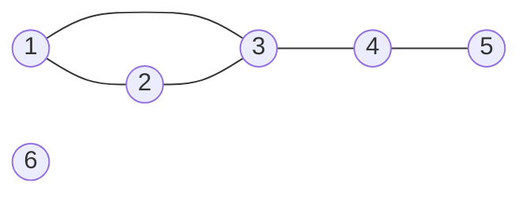
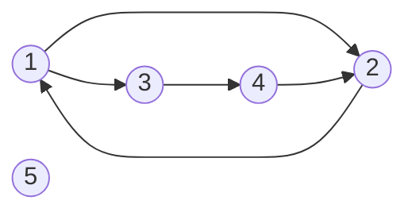
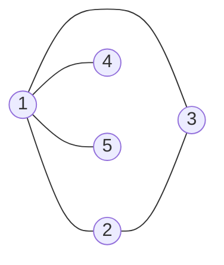
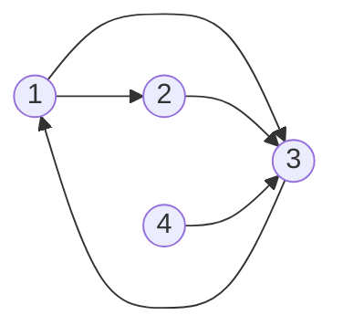

# Introducere in grafuri

Multe probleme vorbesc despre **obiecte** si despre **legaturile** dintre ele: 

- orase legate prin sosele
- elevi care sunt prieteni intre ei
- pagini web care au link-uri unele spre altele. 

Pentru toate aceste situatii folosim acelasi model: **graful**.

Legaturile pot fi de doua feluri:

- **mereu in ambele sensuri** — daca Ion este vecin cu Maria, atunci si Maria este vecina cu Ion. Pentru astfel de legaturi folosim un **graf neorientat**.
- **posibil si intr-un singur sens** — o strada poate avea sens unic, dar si sens dublu; un link de pe o pagina spre alta (pagina la care ajungi nu are neaparat un link inapoi). Pentru astfel de legaturi folosim un **graf orientat**.

---

## Graful neorientat

Un **graf neorientat** este o pereche `G = (X, U)`, unde:

- `X` este o multime finita si nevida ale carei elemente se numesc **noduri** (sau **varfuri**). Nodurile se numeroteaza de obicei `1, 2, ..., n`, deci `X = {1, 2, ..., n}`.
- `U` este o multime de perechi **neordonate** de noduri distincte, numite **muchii**. Muchia dintre nodurile `x` si `y` se noteaza `[x, y]`.

Numarul de noduri se noteaza cu `n`, iar numarul de muchii cu `m`.

### Exemplu

`n = 6`, `X = {1, 2, 3, 4, 5, 6}`

`U = {[1, 2], [1, 3], [2, 3], [3, 4], [4, 5]}`, deci `m = 5`.



La desen, nodurile sunt cercuri, iar muchiile sunt **linii** intre ele.

> [!NOTE] Observatie
> Perechea este **neordonata**, adica ordinea nodurilor nu conteaza: `[1, 2]` si `[2, 1]` sunt **aceeasi muchie**. De aceea, intre doua noduri exista **cel mult o muchie**.

> [!IMPORTANT] Important
> O muchie leaga doua noduri **distincte**: nu exista muchie de la un nod la el insusi (`[3, 3]` nu este muchie).

> [!NOTE] Observatie
> Desenul nu face parte din graf. Conteaza doar **ce noduri sunt legate**, nu unde sunt asezate cercurile. Acelasi graf poate fi desenat in multe feluri.

---

## Graful orientat

Un **graf orientat** este o pereche `G = (X, U)`, unde:

- `X = {1, 2, ..., n}` este multimea **nodurilor**, la fel ca la graful neorientat;
- `U` este o multime de perechi **ordonate** de noduri distincte, numite **arce**. Arcul de la `x` la `y` se noteaza `(x, y)`.

In arcul `(x, y)`, nodul `x` este **extremitatea initiala**, iar `y` este **extremitatea finala**. Numarul de arce se noteaza tot cu `m`.

### Exemplu

`n = 5`, `X = {1, 2, 3, 4, 5}`

`U = {(1, 2), (2, 1), (1, 3), (3, 4), (4, 2)}`, deci `m = 5`.



La desen, arcele sunt **sageti**: arcul `(x, y)` pleaca din `x` si intra in `y`.

> [!NOTE] Observatie
> Perechea este **ordonata**: `(1, 2)` si `(2, 1)` sunt **arce diferite**. Intre doua noduri pot exista 0, 1 sau 2 arce — cel mult cate unul in fiecare sens. In exemplu, intre `1` si `2` exista ambele arce.

> [!IMPORTANT] Important
> Si la graful orientat, un arc leaga doua noduri **distincte**: `(3, 3)` nu este arc.

### Pe scurt

| | Graf neorientat | Graf orientat |
|---|---|---|
| legatura se numeste | muchie | arc |
| notatie | `[x, y]` | `(x, y)` |
| ordinea conteaza? | nu: `[x, y]` = `[y, x]` | da: `(x, y)` ≠ `(y, x)` |
| la desen | linie | sageata |
| legaturi intre doua noduri | cel mult 1 | cel mult 2 (cate una in fiecare sens) |

---

## Adiacenta si incidenta

### La graful neorientat

- Nodurile `x` si `y` sunt **adiacente** (sau **vecine**) daca exista muchia `[x, y]`.
- Muchia `[x, y]` este **incidenta** cu nodul `x` si cu nodul `y`. Nodurile `x` si `y` sunt **extremitatile** muchiei.

In exemplul de mai sus: vecinii lui `3` sunt `1`, `2` si `4`. Muchiile incidente cu `3` sunt `[1, 3]`, `[2, 3]` si `[3, 4]`. Nodul `6` nu are niciun vecin.

### La graful orientat

Pentru un arc `(x, y)`:

- `y` este **succesor** al lui `x`, iar `x` este **predecesor** al lui `y`;
- arcul este **incident spre exterior** cu `x` (iese din `x`) si **incident spre interior** cu `y` (intra in `y`);
- nodurile `x` si `y` sunt **adiacente**.

In exemplul de mai sus: succesorii lui `1` sunt `2` si `3`. Predecesorii lui `2` sunt `1` si `4`.

> [!WARNING] Atentie
> La graful orientat, doua noduri sunt adiacente daca exista **macar unul** din arcele `(x, y)` sau `(y, x)`. In exemplu, `2` si `4` sunt adiacente datorita arcului `(4, 2)`, chiar daca arcul `(2, 4)` nu exista. Dar `4` **nu** este succesor al lui `2`, ci predecesor.

---

## Gradul unui nod

### La graful neorientat

**Gradul** nodului `x`, notat `d(x)`, este numarul de muchii incidente cu `x`, adica **numarul de vecini** ai lui `x`.

Pentru graful neorientat din exemplu:

| Nod | 1 | 2 | 3 | 4 | 5 | 6 |
|---|---|---|---|---|---|---|
| vecini | 2, 3 | 1, 3 | 1, 2, 4 | 3, 5 | 4 | — |
| `d(x)` | 2 | 2 | 3 | 2 | 1 | 0 |

Doua tipuri de noduri au nume speciale:

- un nod cu `d(x) = 0` este **nod izolat** (in exemplu: `6`);
- un nod cu `d(x) = 1` este **nod terminal** (in exemplu: `5`).

### La graful orientat

La graful orientat, fiecare nod are **doua** grade:

- **gradul exterior** `d⁺(x)` — numarul de arce care **ies** din `x`, adica numarul de succesori;
- **gradul interior** `d⁻(x)` — numarul de arce care **intra** in `x`, adica numarul de predecesori.

Pentru graful orientat din exemplu:

| Nod | 1 | 2 | 3 | 4 | 5 |
|---|---|---|---|---|---|
| succesori | 2, 3 | 1 | 4 | 2 | — |
| predecesori | 2 | 1, 4 | 1 | 3 | — |
| `d⁺(x)` | 2 | 1 | 1 | 1 | 0 |
| `d⁻(x)` | 1 | 2 | 1 | 1 | 0 |

Un nod cu `d⁺(x) = d⁻(x) = 0` este **nod izolat** (in exemplu: `5`).

> [!TIP] Sfat
> Ca sa nu le incurci: **plus** = arcele care **pleaca** din nod (spre exterior), **minus** = arcele care **intra** in nod (spre interior).

> [!NOTE] Observatie
> In unele culegeri, gradul exterior se numeste **grad extern**, iar gradul interior **grad intern**. Denumirile inseamna acelasi lucru.

---

## Suma gradelor

### La graful neorientat

> [!IMPORTANT] Important
> Intr-un graf neorientat cu `m` muchii, suma gradelor tuturor nodurilor este `2m`:
>
> `d(1) + d(2) + ... + d(n) = 2m`

**De ce?** Fiecare muchie `[x, y]` adauga `1` la gradul lui `x` si `1` la gradul lui `y`. Deci fiecare muchie se numara de **doua ori** in suma gradelor.

Verificare pe exemplu: `2 + 2 + 3 + 2 + 1 + 0 = 10 = 2 · 5`.

**Consecinta.** Suma gradelor este mereu un numar par. De aici rezulta ca **numarul nodurilor cu grad impar este par** (o suma cu un numar impar de termeni impari ar fi impara). In exemplu, nodurile cu grad impar sunt `3` si `5` — doua noduri.

### La graful orientat

> [!IMPORTANT] Important
> Intr-un graf orientat cu `m` arce:
>
> `d⁺(1) + d⁺(2) + ... + d⁺(n) = d⁻(1) + d⁻(2) + ... + d⁻(n) = m`

**De ce?** Fiecare arc `(x, y)` adauga `1` la gradul exterior al lui `x` si `1` la gradul interior al lui `y`. Deci fiecare arc se numara **o data** in suma gradelor exterioare si **o data** in suma gradelor interioare.

Verificare pe exemplu: `2 + 1 + 1 + 1 + 0 = 5` si `1 + 2 + 1 + 1 + 0 = 5`.

---

## Numarul maxim de muchii si de arce

**La graful neorientat.** Un nod poate avea cel mult `n - 1` vecini (toate celelalte noduri), deci `d(x) ≤ n - 1`. Cele mai multe muchii le avem cand oricare doua noduri sunt legate. Numarul de perechi de noduri distincte este:

`n(n - 1) / 2`

**La graful orientat.** Si aici `d⁺(x) ≤ n - 1` si `d⁻(x) ≤ n - 1`. Intre oricare doua noduri pot exista doua arce (cate unul in fiecare sens), deci numarul maxim de arce este dublu:

`n(n - 1)`

| `n` | max. muchii (neorientat) | max. arce (orientat) |
|---|---|---|
| 3 | 3 | 6 |
| 4 | 6 | 12 |
| 5 | 10 | 20 |
| 10 | 45 | 90 |

---

## Cate grafuri exista cu `n` noduri

**La graful neorientat.** Avem `n(n - 1) / 2` muchii posibile. Fiecare dintre ele poate sa existe sau sa nu existe in graf — doua variante pentru fiecare. Numarul de grafuri neorientate cu `n` noduri este:

`2^(n(n - 1) / 2)`

De exemplu, pentru `n = 3` muchiile posibile sunt `[1, 2]`, `[1, 3]`, `[2, 3]`, deci exista `2^3 = 8` grafuri:

| # | Muchii | # | Muchii |
|---|---|---|---|
| 1 | — (nicio muchie) | 5 | `[1, 2]`, `[1, 3]` |
| 2 | `[1, 2]` | 6 | `[1, 2]`, `[2, 3]` |
| 3 | `[1, 3]` | 7 | `[1, 3]`, `[2, 3]` |
| 4 | `[2, 3]` | 8 | `[1, 2]`, `[1, 3]`, `[2, 3]` |

**La graful orientat.** Avem `n(n - 1)` arce posibile, fiecare existand sau nu:

`2^(n(n - 1))`

Pentru `n = 3`: `2^6 = 64` de grafuri orientate.

> [!IMPORTANT] Important
> Nodurile sunt **numerotate**, iar doua grafuri cu muchii diferite se numara separat, chiar daca desenele lor "arata la fel". De exemplu, grafurile `2` si `4` din tabel (o singura muchie, `[1, 2]`, respectiv `[2, 3]`) se numara ca doua grafuri distincte.

---

## Program: calculul gradelor

Gradele se pot calcula direct din lista de muchii, fara sa memoram graful. Pentru fiecare muchie citita, crestem gradele extremitatilor ei.

### Graf neorientat

Se citesc `n` si `m`, apoi `m` perechi `x y` reprezentand muchiile unui graf neorientat. Sa se afiseze gradele nodurilor `1, 2, ..., n`.

```cpp
#include <iostream>
using namespace std;

int n, m, i, x, y, d[101];

int main()
{
    cin >> n >> m;
    for (i = 1; i <= m; i++)
    {
        cin >> x >> y;
        d[x]++;     // muchia [x, y] e incidenta cu x
        d[y]++;     // ... si cu y
    }
    for (i = 1; i <= n; i++)
    {
        cout << d[i] << " ";
    }
    return 0;
}
```

**Intrare:**
```
6 5
1 2
1 3
2 3
3 4
4 5
```

**Afisare:**
```
2 2 3 2 1 0
```

### Graf orientat

Se citesc `n` si `m`, apoi `m` perechi `x y` reprezentand arcele unui graf orientat. Sa se afiseze pe prima linie gradele exterioare, iar pe a doua linie gradele interioare ale nodurilor `1, 2, ..., n`.

```cpp
#include <iostream>
using namespace std;

int n, m, i, x, y, gradExterior[101], gradInterior[101];

int main()
{
    cin >> n >> m;
    for (i = 1; i <= m; i++)
    {
        cin >> x >> y;
        gradExterior[x]++;  // arcul (x, y) iese din x
        gradInterior[y]++;  // ... si intra in y
    }
    for (i = 1; i <= n; i++)
    {
        cout << gradExterior[i] << " ";
    }
    cout << "\n";
    for (i = 1; i <= n; i++)
    {
        cout << gradInterior[i] << " ";
    }
    return 0;
}
```

**Intrare:**
```
5 5
1 2
2 1
1 3
3 4
4 2
```

**Afisare:**
```
2 1 1 1 0
1 2 1 1 0
```

> [!NOTE] Observatie
> Singura diferenta dintre cele doua programe este ce facem cu o legatura citita: la muchia `[x, y]` crestem acelasi grad pentru ambele noduri, iar la arcul `(x, y)` crestem gradul **exterior** al lui `x` si gradul **interior** al lui `y`.

---

## Exercitii rezolvate

### 1. Suma gradelor

Un graf neorientat are `8` noduri si `11` muchii. Cat este suma gradelor nodurilor?

**Rezolvare.** Suma gradelor este `2m = 2 · 11 = 22`. Numarul de noduri nu conteaza.

### 2. Numarul de arce

Un graf orientat are `6` noduri, iar suma gradelor interioare ale nodurilor este `9`. Cate arce are graful? Cat este suma gradelor exterioare?

**Rezolvare.** Suma gradelor interioare este egala cu `m`, deci graful are `9` arce. Suma gradelor exterioare este tot `m = 9`.

### 3. Numarul maxim de muchii si de arce

Care este numarul maxim de muchii ale unui graf neorientat cu `7` noduri? Dar numarul maxim de arce ale unui graf orientat cu `7` noduri?

**Rezolvare.** Neorientat: `7 · 6 / 2 = 21` de muchii. Orientat: `7 · 6 = 42` de arce.

### 4. Gradele pot fi `1, 2, 2, 3, 3`?

Exista un graf neorientat cu `5` noduri ale carui noduri au gradele `1, 2, 2, 3, 3`?

**Rezolvare.** Nu. Suma gradelor este `1 + 2 + 2 + 3 + 3 = 11`, un numar impar, dar suma gradelor trebuie sa fie `2m`, adica para. (Altfel spus: graful ar avea `3` noduri de grad impar, iar numarul lor trebuie sa fie par.)

### 5. Gradele pot fi `3, 3, 1, 1`?

Exista un graf neorientat cu `4` noduri ale carui noduri au gradele `3, 3, 1, 1`?

**Rezolvare.** Suma este `8`, un numar par, deci testul de la exercitiul anterior nu ne spune nimic. Ne uitam mai atent:

- un nod de grad `3` intr-un graf cu `4` noduri este legat de **toate** celelalte trei noduri;
- avem doua astfel de noduri, deci fiecare dintre celelalte doua noduri este legat de **amandoua** — adica are gradul cel putin `2`.

Dar celelalte doua noduri ar trebui sa aiba gradul `1`. Contradictie, deci **nu exista** un astfel de graf.

> [!WARNING] Atentie
> Suma para a gradelor este o conditie **necesara**, dar **nu suficienta**. Daca suma este impara, graful sigur nu exista. Daca suma este para, graful **poate** sa existe sau nu — trebuie verificat.

### 6. Gradele pot fi `4, 2, 2, 1, 1`?

Exista un graf neorientat cu `5` noduri ale carui noduri au gradele `4, 2, 2, 1, 1`?

**Rezolvare.** Suma este `10`, deci graful ar avea `m = 5` muchii. Nodul de grad `4` trebuie legat de toate celelalte. Fie acesta nodul `1`: muchiile `[1, 2]`, `[1, 3]`, `[1, 4]`, `[1, 5]`. Nodurile `4` si `5` au deja gradul `1`, gata. Nodurile `2` si `3` au gradul `1` si au nevoie de inca o muchie fiecare: adaugam `[2, 3]`.



Gradele sunt `d(1) = 4`, `d(2) = 2`, `d(3) = 2`, `d(4) = 1`, `d(5) = 1`. Deci graful **exista**.

### 7. Grade intr-un graf orientat

Se da graful orientat cu `4` noduri si arcele `(1, 2)`, `(1, 3)`, `(2, 3)`, `(3, 1)`, `(4, 3)`.



a) Care nod are gradul interior maxim?
b) Care noduri au gradul interior egal cu gradul exterior?

**Rezolvare.** Facem tabelul gradelor:

| Nod | 1 | 2 | 3 | 4 |
|---|---|---|---|---|
| `d⁺(x)` | 2 | 1 | 1 | 1 |
| `d⁻(x)` | 1 | 1 | 3 | 0 |

a) Nodul `3`, cu `d⁻(3) = 3` (arcele vin din `1`, `2` si `4`).
b) Doar nodul `2`, cu `d⁺(2) = d⁻(2) = 1`.

Verificare: `2 + 1 + 1 + 1 = 5` si `1 + 1 + 3 + 0 = 5`, egale cu numarul de arce.

### 8. Numarul de grafuri

a) Cate grafuri neorientate cu `4` noduri exista?
b) Cate grafuri orientate cu `3` noduri exista?

**Rezolvare.**

a) Numarul de muchii posibile este `4 · 3 / 2 = 6`, deci exista `2^6 = 64` de grafuri neorientate.
b) Numarul de arce posibile este `3 · 2 = 6`, deci exista tot `2^6 = 64` de grafuri orientate.

---

## Formule de memorat

| | Graf neorientat | Graf orientat |
|---|---|---|
| grad | `d(x)` = numarul de vecini | `d⁺(x)` = numarul de succesori, `d⁻(x)` = numarul de predecesori |
| grad maxim | `d(x) ≤ n - 1` | `d⁺(x) ≤ n - 1`, `d⁻(x) ≤ n - 1` |
| suma gradelor | `Σ d(x) = 2m` | `Σ d⁺(x) = Σ d⁻(x) = m` |
| nr. maxim de muchii / arce | `n(n - 1) / 2` | `n(n - 1)` |
| nr. de grafuri cu `n` noduri | `2^(n(n - 1) / 2)` | `2^(n(n - 1))` |
| nod izolat | `d(x) = 0` | `d⁺(x) = d⁻(x) = 0` |
| nod terminal | `d(x) = 1` | — |
