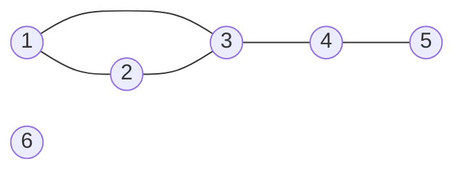
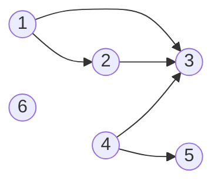
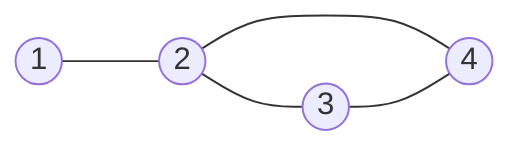
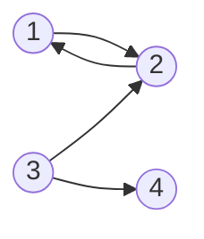

# Introducere in grafuri

Multe probleme vorbesc despre **obiecte** si despre **legaturile** dintre ele:

- orase legate prin sosele
- elevi care sunt prieteni intre ei
- pagini web care au link-uri unele spre altele

Pentru toate aceste situatii folosim acelasi model: **graful**. Obiectele se numesc **noduri**, iar legaturile dintre ele se numesc **muchii** sau **arce**, dupa cum vedem mai jos.

Legaturile pot fi de doua feluri:

- **in ambele sensuri.** Daca Ion este prieten cu Maria, atunci si Maria este prietena cu Ion. Pentru astfel de legaturi folosim un **graf neorientat**.
- **intr-un singur sens.** Daca o pagina web are un link spre alta pagina, a doua pagina nu are neaparat un link inapoi. La fel, o strada poate avea sens unic. Pentru astfel de legaturi folosim un **graf orientat**.

---

## Aceleasi noduri, doua feluri de legaturi

In aceasta lectie folosim mereu **aceleasi 6 noduri**, numerotate `1, 2, ..., n` (aici `n = 6`). Le vom lega o data cu linii (graf neorientat) si o data cu sageti (graf orientat), ca sa vedem usor diferenta.

---

## Graful neorientat

Legaturile dintre noduri se numesc **muchii**. Muchia dintre nodurile `x` si `y` se noteaza `[x, y]`. Numarul de muchii se noteaza cu `m`.

### Exemplu

Nodurile sunt `1, 2, 3, 4, 5, 6`, iar muchiile sunt `[1, 2]`, `[1, 3]`, `[2, 3]`, `[3, 4]`, `[4, 5]`. Deci `n = 6` si `m = 5`.

La desen, nodurile sunt cercuri, iar muchiile sunt **linii**.

> [!IMPORTANT] Reguli pentru muchii
> - Ordinea nodurilor **nu conteaza**: `[1, 2]` si `[2, 1]` sunt **aceeasi muchie**.
> - Intre doua noduri exista **cel mult o muchie**.
> - Nu exista muchie de la un nod la el insusi (`[3, 3]` nu este muchie).

> [!NOTE] Retine
> Graf neorientat = noduri + **muchii** (linii). Muchia `[x, y]` merge in ambele sensuri.

---

## Graful orientat

Legaturile dintre noduri se numesc **arce**. Arcul de la `x` la `y` se noteaza `(x, y)`: el **pleaca din `x`** si **ajunge in `y`**. Numarul de arce se noteaza tot cu `m`.

### Exemplu

Aceleasi noduri `1, 2, 3, 4, 5, 6`, iar arcele sunt `(1, 2)`, `(1, 3)`, `(2, 3)`, `(4, 3)`, `(4, 5)`. Deci `n = 6` si `m = 5`.

La desen, arcele sunt **sageti**: arcul `(x, y)` pleaca din `x` si intra in `y`.

> [!IMPORTANT] Reguli pentru arce
> - Ordinea nodurilor **conteaza**: `(1, 2)` si `(2, 1)` sunt **arce diferite**.
> - Intre doua noduri pot exista 0, 1 sau 2 arce, cel mult unul in fiecare sens. De exemplu, putem avea si `(1, 2)`, si `(2, 1)`.
> - Nu exista arc de la un nod la el insusi (`(3, 3)` nu este arc).

> [!NOTE] Retine
> Graf orientat = noduri + **arce** (sageti). Arcul `(x, y)` merge doar de la `x` la `y`.

---

## Neorientat si orientat pe scurt

| | Graf neorientat | Graf orientat |
|---|---|---|
| legatura se numeste | muchie | arc |
| notatie | `[x, y]` | `(x, y)` |
| ordinea conteaza? | nu: `[x, y]` = `[y, x]` | da: `(x, y)` ≠ `(y, x)` |
| la desen | linie | sageata |
| legaturi intre doua noduri | cel mult 1 | cel mult 2 (cate una in fiecare sens) |

> [!TIP] Cum scrie la BAC
> In enunturi graful apare ca o pereche `G = (X, U)`, unde `X` este multimea nodurilor, iar `U` este multimea muchiilor (sau a arcelor). Pentru exemplele de mai sus: `X = {1, 2, 3, 4, 5, 6}` si `U = {[1, 2], [1, 3], [2, 3], [3, 4], [4, 5]}`, respectiv `U = {(1, 2), (1, 3), (2, 3), (4, 3), (4, 5)}`.

---

## Noduri adiacente

### La graful neorientat

Nodurile `x` si `y` sunt **adiacente** (sau **vecine**) daca exista muchia `[x, y]`.

In exemplul neorientat: vecinii lui `3` sunt `1`, `2` si `4`. Nodul `6` nu are niciun vecin.

Despre muchia `[x, y]` spunem ca este **incidenta** cu nodurile `x` si `y` (ele sunt **extremitatile** ei). Muchiile incidente cu `3` sunt `[1, 3]`, `[2, 3]` si `[3, 4]`.

### La graful orientat

Nodurile `x` si `y` sunt **adiacente** daca exista **macar unul** dintre arcele `(x, y)` sau `(y, x)`.

In exemplul orientat: nodurile `3` si `4` sunt adiacente datorita arcului `(4, 3)`, chiar daca arcul `(3, 4)` nu exista. Nodurile `1` si `6` nu sunt adiacente.

> [!WARNING] Atentie
> Adiacenta nu tine cont de sensul sagetii: conteaza doar daca nodurile sunt legate printr-un arc, indiferent in ce sens. Sensul devine important in lectia urmatoare, cand numaram arcele care **pleaca** dintr-un nod si arcele care **intra** in el.

> [!NOTE] Retine
> **Adiacente** = legate printr-o muchie / un arc. **Incidenta** = muchia si nodurile ei.

---

## Exercitii rezolvate

### 1. Citim un graf neorientat

Se da graful neorientat din desen:

Scrie `n`, `m` si multimea muchiilor. Care sunt vecinii lui `2`? Care sunt muchiile incidente cu `1`?

**Rezolvare.** Graful are `n = 4` noduri si `m = 4` muchii: `[1, 2]`, `[2, 3]`, `[2, 4]`, `[3, 4]`. Vecinii lui `2` sunt `1`, `3` si `4`. Singura muchie incidenta cu `1` este `[1, 2]`.

### 2. Citim un graf orientat

Se da graful orientat din desen:

a) Cate arce are graful?
b) Sunt adiacente nodurile `1` si `2`? Dar `2` si `4`?
c) Exista arcul `(2, 3)`?

**Rezolvare.**

a) Graful are `m = 4` arce: `(1, 2)`, `(2, 1)`, `(3, 2)`, `(3, 4)`. Observa ca intre `1` si `2` exista arce in ambele sensuri.
b) `1` si `2` sunt adiacente (exista `(1, 2)` si `(2, 1)`). `2` si `4` **nu** sunt adiacente: nu exista nici `(2, 4)`, nici `(4, 2)`.
c) Nu. Exista `(3, 2)`, dar arcele `(3, 2)` si `(2, 3)` sunt diferite.

---

## Ce urmeaza

In lectia [Gradul unui nod](/cpp/algoritmi/clasa-a-11a/grafuri/gradul-unui-nod) numaram cate muchii (sau arce) are fiecare nod si descoperim formule care ne scutesc de multe calcule.
